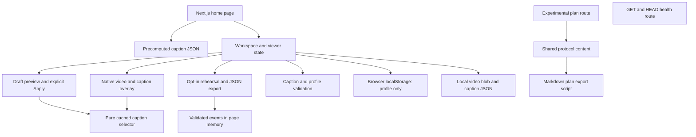

# Codebase map

Graphifyy 0.9.92 mapped 21 code files into 93 nodes and 187 edges using local deterministic extraction. No providers, agents, semantic extraction, MCP or watchers ran.

- [Machine-readable graph](codebase-map.json)
- [Interactive Graphify map](codebase-map.html) — optional visualization uses CDN-hosted vis.js when opened; the application does not depend on it.
- [Input hashes and method](codebase-map-inputs.json)



The diagram was reviewed against the implementation; it is a compact manual guide, not a claim that static extraction discovers every React interaction. The JSON graph provides extracted symbol relationships. Two files yielded no symbols: `scripts/browser-smoke.mjs` and `tests/session.test.ts` (anonymous test/automation functions). Graphify does not prove runtime behavior, annotation accuracy or complete alias/data-flow coverage. Caption JSON, media and participant-session behavior were checked separately.

Refresh after structural changes with the isolated runtime:

```sh
/Users/hamza/runtimes/graphify/.venv/bin/python scripts/map-codebase.py
```

On another machine, rebuild an isolated environment from `requirements-tools.txt`; do not copy an existing Python environment. Mapping is a manual task, never a startup hook or background service.


## Source-caption follow-up

The earlier extracted graph is a historical snapshot. New manually traced path: pinned `data/sources/big-buck-captions/` SRT + `data/authoring/big-buck-bunny-lexicon.json` → `scripts/import-demo-captions.ts` → strict `src/lib/srt.ts` parser and `videoSchema` → bundled/public JSON → Workspace/VideoPlayer/Preferences. The importer validates source and exact-video hashes, writes attribution and provenance, and has no network calls. `resolveCaption` discloses the cue-density proxy. `tests/srt.test.ts`, caption provenance tests and the updated browser smoke script cover these boundaries. No Graphify skill or agents were activated for this follow-up.
