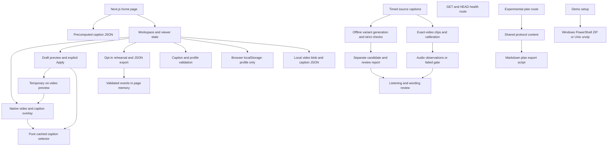

# Current freshness notice

The library integration changed `src/app/page.tsx`, the schema/parser, player/timeline/workspace and added `screening-room.tsx`, subtitle import/preparation and regression checks. The saved graph below predates those changes; its input manifest is stale for them. No new Graphify activation was requested for this follow-up. Read the current [library evidence](verification/library-2026-10-24/README.md) and source for these boundaries.

# Codebase map

Refreshed on 24 October 2026 after the current [model investigation and component cleanup](audits/2026-10-24-investigation.md). The manifest records 63 source/config/test files, 334 nodes and 740 edges. Local deterministic Graphify extraction used zero semantic/model tokens and no agents, providers, MCP or watchers. The later media helper is now inventoried; eight source files yield no extracted symbols. The current input manifest is authoritative for byte hashes and scope; cross-platform line endings can change those hashes.

- [Machine-readable graph](codebase-map.json)
- [Interactive Graphify map](codebase-map.html) — optional visualization uses CDN-hosted vis.js when opened; the application does not depend on it.
- [Input hashes and method](codebase-map-inputs.json)



The diagram is a manually checked boundary guide, not proof that extraction discovers every React interaction. The committed map inventories code under src/scripts/tests plus root Next.js/package/TypeScript configuration. Some anonymous browser/test files and the PowerShell bridge yield no symbols; see extraction warnings in the dated fixes evidence. Graphify does not prove runtime behavior, audio capability, annotation accuracy or complete alias/data-flow coverage. Source JSON, media, generated evidence and participant behavior require separate checks.

Refresh after structural changes with the isolated runtime:

```sh
python scripts/map-codebase.py
```

Use an isolated Python environment with the pinned Graphify package from `requirements-tools.txt`, not an arbitrary system interpreter. On another machine, rebuild that environment; do not copy it. Mapping is a manual authorized task, never a startup hook or background service. Refresh after final code changes, then compare the input hashes before relying on the map.


## Source-caption follow-up

The current map includes the importer/parser path and newer preparation modules. Pinned SRT + editorial lexicon → importer → strict SRT parser/schema → bundled/public JSON → Workspace/VideoPlayer/Preferences. The importer preserves source timing and hashes the exact movie. Model candidates remain separate; there is no automatic edge from model output into playback. Failed audio calibration and rejected wording require review, not an installation shortcut.

The broad local `graphify-out/` map is refreshed separately with code-only CLI extraction. It also classifies structured JSON/evidence and therefore has a different scope/count from the committed source map. Documents/media were not semantically indexed; a broad scan is not proof of complete understanding. Local ignored outputs may be absent in another checkout. The dated [fixes report](audits/2026-10-24-fixes.md) records freshness and tool limits.

## Current ownership boundaries

`Workspace` orchestrates the viewer; `useLocalMedia` owns local files/blob cleanup, `useRehearsal` owns event capture and stopped time, and track notice/timeline/import panels own presentation. `useVideoPlayback` owns media readiness, events, preview timing and transport actions; player controls and caption display/feedback are separate views. Preferences retain their draft identity with separate style, preview and readability views. Active rehearsal answers/export and pre-start consent are separate phases; snapshot construction is pure.

Offline source caption generation → strict variant/completion guards → separate candidates. Contextual review preparation → hash-bound pending receipt → explicit human review; there is no automatic edge into playback. The refreshed source map includes these boundaries. The broad ignored graphify-out graph from earlier sessions was not refreshed and is historical. Graphs cannot establish complete React wiring, sound correctness or runtime behavior. Current behavior evidence is linked from the investigation.

Integrity warning from the cached raw extraction: 169 dangling endpoint references and 28 same-endpoint directed pairs under the diagnostic's default deduplicating build. The committed mapper uses a DiGraph; all stored endpoints are bound, but that does not resolve the raw reference/coverage uncertainty. Its `dedup=False` controls entity merging, not parallel-edge collapse. See [raw diagnostics](verification/investigation-2026-10-24/reports/map-diagnostics.json). No claim of complete or corruption-free call extraction is made.
