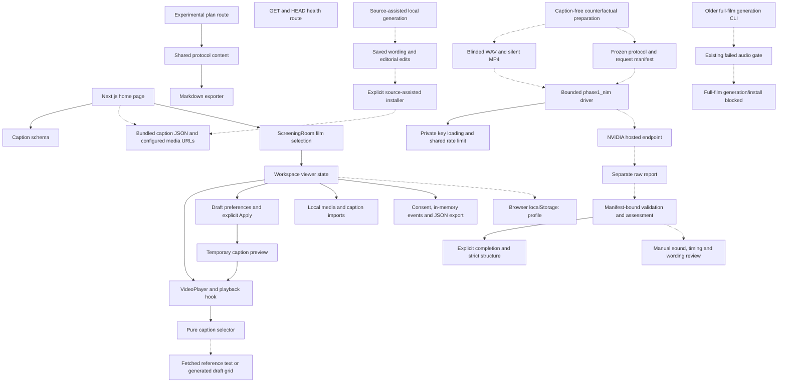

# Codebase map

**28 October 2026 freshness note:** the snapshot predates the new optional media-only subtitle selector, experimental metadata/binding guards, source-guided richness option/coverage guards, and offline full-film/source-rewrite generators. Inspect those changed files directly; no mapping skill or refresh was requested. The graph below remains a historical orientation aid.

Refreshed **26 October 2026** for the caption-free NIM investigation. The manifest covers **79 code/config/test files, 436 nodes and 1,019 edges**. All recorded input hashes matched after final code edits. Graphifyy 0.9.92 used local deterministic AST extraction with `parallel=False`: zero semantic/model calls, no agents, providers, watchers or MCP services.

- [Interactive map](codebase-map.html) — the optional viewer loads CDN-hosted vis.js when opened; playback does not depend on it.
- [Machine-readable graph](codebase-map.json)
- [Input hashes, version and scope](codebase-map-inputs.json)
- [Current raw extraction diagnostics](verification/nim-counterfactuals-2026-10-26/reports/map-diagnostics.json)
- [Test, audit and model evidence](verification/nim-counterfactuals-2026-10-26/README.md)

**Integrity/coverage warning:** raw extraction has 302 dangling endpoint references and 29 same-endpoint directed edge collapses; 11 inventoried files yield no symbols. The built DiGraph binds stored endpoints but does not resolve those raw omissions. `dedup=False` controls entity merging, not parallel-edge preservation. This map is an orientation aid, not complete or corruption-free runtime/data-flow proof. Media, documents, source JSON and generated evidence are outside AST extraction. The broad ignored `graphify-out/graph.json` from earlier work has a different scope and remains historical; use the committed source map and manifest above.

## Current boundaries

This diagram was checked manually against source and selected graph edges. Dotted file/data relationships require manual inspection; Graphify does not discover them reliably.



`Workspace` coordinates viewer state; `useLocalMedia` owns imported files and blob cleanup; `useRehearsal` owns event capture/stopped time. `useVideoPlayback` owns media events, seeking, playback and preview timing. The selector chooses actual `reference_text` for source-assisted reference comparison and grid wording for personalized viewing. Applying preferences is separate from temporary preview. Current BBB wording remains a source-assisted, unverified draft.

Offline diagnostics are separate from application playback. `nim-counterfactuals.py` prepares inputs and scores saved reports; it performs no inference or installation. `phase1_nim.py` sends only explicit bounded NIM jobs and writes separate reports. Its network call uses private key loading/rate limiting from `nim_client.py`; structured assessment calls `validate_result` then the shared completion/JSON guard. These symbol edges are present in the source graph. File-based protocol/manifest/media/report edges and the absence of installation in the diagnostic driver were checked manually.

The old full-film generator and source-assisted installer are distinct tools. The old generator's existing failed capability gate still blocks full generation/installation. This is a workflow guard, not a security boundary against deliberately editing the file or invoking another installer. No counterfactual output is connected automatically to playback, and no accepted independent NIM track exists.

## Refresh

Run only when mapping is explicitly authorized, using the isolated pinned environment:

```sh
/Users/hamza/runtimes/graphify/.venv/bin/python scripts/map-codebase.py
```

After structural changes, refresh and compare input hashes before relying on the graph. Cross-platform line endings can change byte hashes. Hash freshness proves the map's input snapshot, not complete extraction, annotation correctness, runtime behavior or DHH usefulness. Current diagnostics and manual boundary review are necessary alongside the visualization; do not treat old snapshot counts as current.
