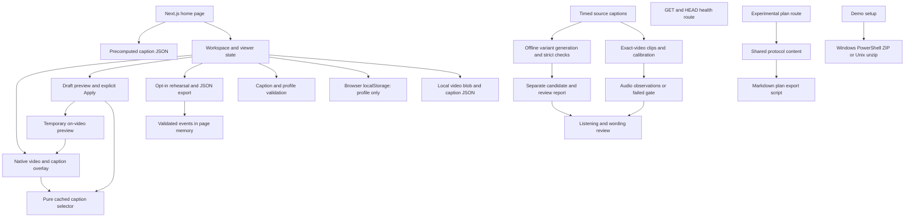

# Codebase map

Freshness exception: this snapshot predates `scripts/media/prepare-library.ps1`, added later on 24 October. It does not map that user-run media-preparation helper. Inspect the helper directly; refresh only with current-prompt authorization. Playback source files have not changed in this media-preparation step.

Refreshed on 24 October 2026 after the player fixes, offline preparation tools and controlled diagnostics. The [input manifest](codebase-map-inputs.json) is authoritative for file counts, hashes, Graphify version and scope. Extraction is local/deterministic; no providers, agents, semantic extraction, MCP or watchers ran.

- [Machine-readable graph](codebase-map.json)
- [Interactive Graphify map](codebase-map.html) — optional visualization uses CDN-hosted vis.js when opened; the application does not depend on it.
- [Input hashes and method](codebase-map-inputs.json)



The diagram is a manually checked boundary guide, not proof that extraction discovers every React interaction. The committed map inventories code under src/scripts/tests plus root Next.js/package/TypeScript configuration. Some anonymous browser/test files and the PowerShell bridge yield no symbols; see extraction warnings in the dated fixes evidence. Graphify does not prove runtime behavior, audio capability, annotation accuracy or complete alias/data-flow coverage. Source JSON, media, generated evidence and participant behavior require separate checks.

Refresh after structural changes with the isolated runtime:

```sh
python scripts/map-codebase.py
```

Use an isolated Python environment with the pinned Graphify package from `requirements-tools.txt`, not an arbitrary system interpreter. On another machine, rebuild that environment; do not copy it. Mapping is a manual authorized task, never a startup hook or background service. Refresh after final code changes, then compare the input hashes before relying on the map.


## Source-caption follow-up

The current map includes the importer/parser path and newer preparation modules. Pinned SRT + editorial lexicon → importer → strict SRT parser/schema → bundled/public JSON → Workspace/VideoPlayer/Preferences. The importer preserves source timing and hashes the exact movie. Model candidates remain separate; there is no automatic edge from model output into playback. Failed audio calibration and rejected wording require review, not an installation shortcut.

The broad local `graphify-out/` map is refreshed separately with code-only CLI extraction. It also classifies structured JSON/evidence and therefore has a different scope/count from the committed source map. Documents/media were not semantically indexed; a broad scan is not proof of complete understanding. Local ignored outputs may be absent in another checkout. The dated [fixes report](audits/2026-10-24-fixes.md) records freshness and tool limits.
