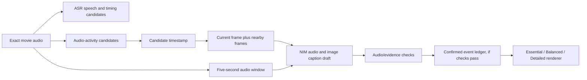

# Sound-triggered screenshots and caption drafts — 27 October 2026

**The proposed architecture is implementable, but screenshots did not establish reliable caption accuracy on the tested NIM path.** The prototype finds audio-activity candidates, extracts correctly aligned frames and prepares audio/image caption requests. A completed muted-image control still invented a thud from visible action, so its output is not accepted as a sound-caption track.

ASR remains the speech branch. It does not reliably discover every environmental sound or provide sound-effect boundaries. This prototype uses local RMS changes as a lightweight **candidate finder**, not a semantic detector. A reliable sound-event detector and subsequent listening/evidence review remain necessary.

## Implementation and scope

This is offline preparation; playback still uses precomputed data. The new work tests the event-triggered frame/context stage, not another full-film run or a new participant study. The preceding [ASR/rendering pilot](../nim-pipeline-2026-10-27/README.md) separately tested those branches. No ASR requests were repeated in this batch.

The project already had coarse still-frame sampling in `scripts/generate-nim-captions.py`, and a separate reference-assisted frame authoring tool. This preparation differs: candidate timing comes from the actual audio, frame times follow the candidates, and no reference captions or their intervals enter generation. The reference-assisted tool was not used.

## Frozen comparison

[Preparation code](prepare.py), [protocol](protocol.json), [input manifest](inputs/manifest.json) and [offline checks](offline-checks.json).

- Scan: exact-hash BBB audio, first 120 seconds, mono PCM16 at 16 kHz.
- Candidates: 80-ms RMS windows, at least 6 dB rise over the prior five-window median and at least −38 dBFS. Ignore first/last eight scan seconds; select the two strongest candidates separated by at least 15 seconds. These thresholds were fixed before inference.
- Selected candidates: **54.6 s** and **87.0 s**. Each gets an identical five-second audio window from two seconds before the candidate to three seconds after.
- Conditions per candidate: audio only; audio + current screenshot; audio + before/current/after screenshots (approximately −0.5/0/+0.5 seconds). Main instruction and generation parameters remain identical. Image modes also include their time annotations, so this is an appended-context comparison, not a pixels-only ablation.
- Two additional controls pair all-zero five-second audio with each candidate's three frames. These deliberately bypass a production zero-signal short-circuit to test whether the model invents audible events from images.
- All eight requests use the same NVIDIA Omni model, `audio_url` and optional `image_url` parts, temperature 0.2, top_k 1, max_tokens 512 and thinking off. One attempt each, no retries; stop after three consecutive capacity errors. The full eight-request budget was used.

Media stays ignored under `artifacts/nim-frame-pipeline-2026-10-27/`. Each JPEG's actual decoded PTS was verified. The first triplet is at 54.083333, 54.583333 and 55.083333 seconds; the second is at 86.5, 87 and 87.5 seconds. Requested times differ by at most one source frame. The nearest actual source timestamps were selected, rather than calculating positions from average FPS. An initially conservative frame-rate-equality guard failed before inference; actual PTS lookup replaced that assumption. The slightly different nominal/average rates are not evidence that this caused earlier caption failures.

Audio/images are cropped derivatives of Big Buck Bunny, © 2008 Blender Foundation / peach.blender.org, CC BY 3.0, extracted for this research diagnostic. They remain local rather than being bundled into playback or this evidence directory.

## Actual results

**Eight requests: six HTTP 200 with explicit `stop`, two HTTP 503 capacity responses.** [Raw comparison report](reports/comparisons.json), [assessment](assessment.json).

| Candidate / condition | Model response, shortened |
| --- | --- |
| 54.6 s, audio only | Train horn and a passing train |
| 54.6 s, one frame | Sustained electronic tone followed by a musical chord |
| 54.6 s, three frames | Sustained musical note as the rabbit stands near a cave |
| 87.0 s, audio only | High-pitched click followed by a low thump |
| 87.0 s, one frame | Thud as a heavy object lands on grass; suggests rabbit dropped/landed |
| 87.0 s, three frames | HTTP 503 — inconclusive |
| First frame set, zero audio | HTTP 503 — inconclusive |
| Second frame set, zero audio | Claims a thud when the rabbit's hand touches/grabs the apple |

The completed mute control has **80,000 zero-valued samples**. Its claimed thud is a definite false sound assertion. The response also describes the image sequence; visible contact cannot establish that the recording contains an impact. This is consistent with visual/prior-driven captioning, but the batch has no same-duration audio-only mute partner and the corresponding normal triplet request was capacity-blocked. Do not turn it into a causal estimate of how much images increased hallucination.

For ordinary audio, screenshots add visible source/location information. That alone is not improved sound accuracy. The before/current/after frames depict the rabbit near a burrow, then a rabbit reaching toward an apple, but still require acoustic evidence for any claimed action sound.

## Evaluation captions stayed isolated

Only **after all generation finished** did we read the licensed reference for a limited comparison: [reference overlap](reference-comparison.json). The 52.6–57.6 s audio window overlaps the source cue `[BUNNY CRACKS NECK]` at 52.499–53.541 s, which is earlier than the marked 54.6 s candidate. The 85–90 s window has no overlapping source cue.

That demonstrates an important limit of the RMS approach: a later activity change need not identify the semantically important event already present elsewhere in the window. It does not prove that other sounds, music or uncaptioned effects are absent. The reference is editorial and incomplete, and there was no independent listening annotation of the windows. No complete accuracy score or frame-assisted improvement is established.

## Verification and next requirement

[Assessment code](assess.py) checks saved media/manifest hashes, identical PCM across the three context modes, decoded frame times and response completion. Preparation checks cover zero input, synthetic onset timing within 80 ms and 15-second candidate separation. These verify the plumbing, not semantic event identity.

The design follows the broad audio-first/visual-grounding idea described by [TAC-V](https://arxiv.org/html/2602.15766v2), whose trained audio captioner supplies timestamped events before visual association. Our RMS candidate finder and hosted Omni requests do not reproduce that specialized capability. The [official Omni media guide](https://docs.nvidia.com/nim/vision-language-models/1.7.0/examples/nemotron-3-nano-omni-30b-a3b-reasoning/api.html) supports audio and image inputs; accepted input shapes do not establish caption correctness.

The useful production sequence is: establish an audible event and its timing, inspect matching frames for source association, keep off-screen/uncertain sources valid, then render detail levels from the same checked event ledger. Images can enrich source identity; they cannot be the sole evidence for a sound. Local zero guards prevent acceptance of exact-silence outputs, but cannot fix wrong source attribution over music or other nonzero audio.

Reference captions and plot were not generation inputs; the reference was read only for the post-generation comparison above. No paid provider, new model weights, agent, named skill, playback-track installation, push or deployment was used. The existing source-assisted player data and failed audio gate are unchanged. The prototype is ready for inspection; caption quality is still unvalidated and the failed mute control prevents automatic acceptance.
