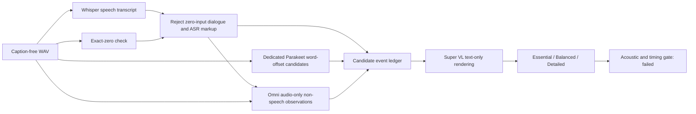

# NVIDIA speech → sound observations → detail rendering pilot

27 October 2026. **The pipeline executes, but it does not yet produce reliable independent DHH sound captions.** Speech transcription and three-level wording work on the constructed positive controls. Speech timing needs review, raw ASR absence handling is unsafe, and the non-speech stage still invents or misidentifies sounds. No caption track or failed capability gate was replaced.

There were **18 NVIDIA-only inference requests**: 11 successful gRPC invocations, five HTTP-200 chat completions and two HTTP-503 capacity responses. Each failed sound cell received one explicit unchanged-payload retry. The full request ceiling was 18; no further generation followed. Qwen3-ASR was not run because no applicable free hosted NIM route was verified. Whisper and the dedicated Parakeet ASR used their actual NVIDIA speech endpoints, rather than the chat-model list.

## Pipeline tested

Raw ASR was deliberately called on silent controls to measure its behavior. The subsequent local guard prevents accepting their output; exact zero is a signal fact, not a model prediction. The sound branch bypassed the all-zero fixture. This safeguard is limited to exact zeros and does not identify silence, speech or source identity in arbitrary nonzero audio.

## Inputs, API access and resources

The [initial protocol](protocol.json) and [media manifest](inputs/asr.json) were fixed before inference. Five mono 16-kHz PCM16 fixtures were used:

| Cell | Input | Evaluation reference |
| --- | --- | --- |
| p01 | 2.5924375-second synthetic speech from the preceding trial | Known phrase: “Nine silver spoons rest beside the red kettle.” |
| p02 | Ten seconds of digital-zero PCM | No speech or sound |
| p03 | Ten seconds with eight identical dog-source bursts | Non-speech dog source, no dialogue |
| p04 | Same speech inserted at +0.5 seconds, followed by dog-source bursts at 4, 6 and 8 seconds | Known words, three effects, no temporal overlap |
| p05 | Fixed first ten seconds of the exact-hash BBB edit | Actual film audio; no independent listening annotation |

The dog recording is the existing ESC-10 control; see [attribution](../nim-counterfactuals-2026-10-26/control-attribution.json). Mixtures were reconstructed sample-for-sample during assessment. The BBB window was selected by a fixed origin, not caption timestamps. Existing subtitles, reference captions, plot and expected effect labels were never model inputs. The sound stage received only actual audio plus our newly generated ASR words as uncertain context. ASR markup such as `*Crowing*` and `♪` was not passed as a sound-source hint.

Whisper used `grpc.nvcf.nvidia.com:443`, function `b702f636-f60c-4a3d-a6f4-f3568c13bd7d`, language `en`, matching [NVIDIA's hosted example](https://build.nvidia.com/openai/whisper-large-v3/api). The key already in the local environment worked. After Whisper returned no word offsets, a bounded follow-up used the [dedicated Parakeet TDT v2 endpoint](https://build.nvidia.com/nvidia/parakeet-tdt-0_6b-v2/api), function `d3fe9151-442b-4204-a70d-5fcc597fd610`, language `en-US`, with word offsets requested.

The isolated runtime is `/Users/hamza/runtimes/scenecaptions-nim-asr`. [Setup record](runtime-setup.json) and [exact client package versions](client-requirements.lock.txt) are saved here and under the user's setup-record directory. Installed client versions include NVIDIA Riva client 2.27.0 and grpcio 1.85.0. No local recognition model weights, GPU/container, persistent service, new API key, paid provider, hook or agent was required. Existing unrelated Python environments and global PATH were not modified.

## Stage results

| Stage | Actual result | Conclusion |
| --- | --- | --- |
| Whisper words | Exact phrase on clean speech and speech-plus-effects | Positive transcription controls passed; not a film-wide accuracy claim |
| Whisper absence | `you` on digital silence; `*Crowing*` on dog-only audio; `♪` on BBB opening | Raw output cannot become trusted dialogue or a sound ledger without checks |
| Whisper timing | Word offsets requested, but none returned on the spoken positive controls | This hosted route did not supply the requested timing in these calls |
| Parakeet words | Same phrase correctly recovered on both positive controls | Useful separate ASR candidate |
| Parakeet absence | Empty transcript on dog audio; repeated `<unk>` tokens on digital silence | No speech is different from no sound; unknown-token output is invalid transcript evidence |
| Parakeet wire-format check | Raw PCM preserves correct speech but still produces repeated unknown tokens on silence | Removing the WAV header did not cure the silence anomaly |
| Omni clean-speech control | `NO_NON_SPEECH_EVENTS` | Correct on this cell |
| Omni repeated dog | Describes impacts followed by a sustained low electronic tone | Some repetition-related structure, wrong source and an unsupported added event |
| Omni speech plus three barks | “Three distinct metallic clinks” with short attacks/decays | Counts three events but misidentifies the controlled dog source |
| Omni BBB opening | Siren, tone and beep description | Unreviewed; no accepted film-grounding claim |
| Super VL renderer | Three valid levels, stable event IDs, exact dialogue, increasing reuse of supplied detail | Wording/identity contract passed; incorrect source information propagates |

Raw reports: [Whisper access](reports/asr-access.json), [Whisper controls](reports/asr-controls.json), [Parakeet speech/timing](reports/parakeet-timing.json), [Parakeet absence](reports/parakeet-absence.json), [raw-PCM comparison](reports/parakeet-raw-pcm.json), [sound-stage initial calls](reports/sounds.json), [mixed-clip retry](reports/sounds-p04-retry.json), [BBB retry](reports/sounds-p05-retry.json), [renderer](reports/renderer.json).

The two HTTP-503 failures were capacity outcomes, not semantic errors. They remain in the evidence despite successful retries. All successful chat responses ended with explicit `stop`. gRPC transport success does not establish transcript correctness. Initial wrapper reporting labels were corrected with an [audit record](metadata-corrections.json): actual model routing/request hashes and response contents were unchanged; original report bytes remain in the local ignored cache.

## Speech timing is partial

[Timing assessment](assessment.json) interprets Riva offsets in milliseconds, as specified by its [official protobuf contract](https://github.com/nvidia-riva/common/blob/main/riva/proto/riva_asr.proto). The eight word-onset shifts between the original and +0.5-second speech were 0.32, 0.40, 0.48, 0.56, 0.48, 0.56, 0.56 and 0.72 seconds; their median was **0.52 seconds**.

That tracks the constructed delay, but both positive controls contain a zero-duration word (`the`). The mixed clip's final word ends at 3.36 seconds, beyond the known speech signal's 3.09-second end, by 0.27 seconds. This is not an unqualified timing pass. No word-timestamp defaults were guessed from missing protobuf fields: absent zero-valued proto3 start offsets legitimately decode to zero. Unknown/zero-duration word intervals remain flagged. Renderer input keeps final speech/effect times unresolved rather than manufacturing a timed subtitle file.

## What the renderer produced

The following is **an incorrect sound-source example**, retained to show error propagation. The actual controlled source is a dog. The renderer received the unreviewed model observation “metallic clinks,” not the known evaluation label.

| Level | Actual rendered sound text |
| --- | --- |
| Essential | Three distinct metallic clinks are audible. |
| Balanced | Three distinct metallic clinks are audible, each with a sharp attack and brief decay. |
| Detailed | Three distinct metallic clinks are audible, each with a sharp attack and brief decay, occurring at regular intervals. |

The speech sentence remained unchanged at all levels. The renderer selected supplied information without introducing extra source events or timestamps, but could not repair wrong acoustic evidence. [Candidate ledger](ledger-candidate.json) and [renderer assessment](renderer-assessment.json) explicitly reject playback acceptance. This candidate is not a new movie-caption track, source-caption paraphrase or demonstrated DHH improvement.

## Correctness and reproducibility

- [Assessment code](assess-pipeline.py) checked frozen manifest/media hashes, independently reconstructed the speech/effect mixtures, reconstructed each serialized gRPC request from config and exact source bytes, and confirmed the raw-PCM variants use the same source samples. [Assessment](assessment.json) separates each stage and raw output from acceptance.
- [Offline checks](offline-validation.json) passed eight ASR hygiene cases, one valid renderer case and six adversarial renderer cases. They reject unknown event IDs, changed dialogue, missing levels, fabricated timing fields, lost event identities and unknown-token streams. Plausible invented words on nonzero audio remain a semantic problem these guards cannot solve.
- The [existing 35 offline tests](reports/shared-offline-checks.txt) passed in the isolated client runtime. These tests and schema validation do not establish acoustic truth. No application/browser/build test was repeated because this batch changed experiment evidence, not application code.
- Conditional protocols were fixed before each follow-up: [sound branch](sound-protocol.json), [timing](timing-protocol.json), [Parakeet absence](parakeet-absence-protocol.json), [sound retries](sound-retry-protocol.json), [raw PCM](raw-pcm-protocol.json), [renderer](renderer-protocol.json). This is an adaptive diagnostic, not an independent benchmark or preregistered study.
- Media stays ignored under `artifacts/nim-pipeline-2026-10-27/`. Another checkout needs the matching local sources; do not rerun preparation over frozen evidence. `run-asr.py` and the existing chat driver perform actual NVIDIA calls; preparation, rendering-manifest creation, validation and assessment do not.

All interpretation was performed in the main session against constructed controls/dataset labels. No independent listening panel, new human annotation of BBB, representative full-film sample or DHH usability test was conducted. The NIM-hosted setup still hides checkpoint/quantization and some serving details. Model weights alone are not proven to be the cause of every failure.

**Practical outcome:** this gives us an operational NVIDIA speech branch and a working three-level text renderer. The missing requirement remains reliable, independently grounded non-speech events and their timing. Full-film generation and installation remain blocked; the current source-assisted playback draft is unchanged. No push or deployment was performed for this task.
